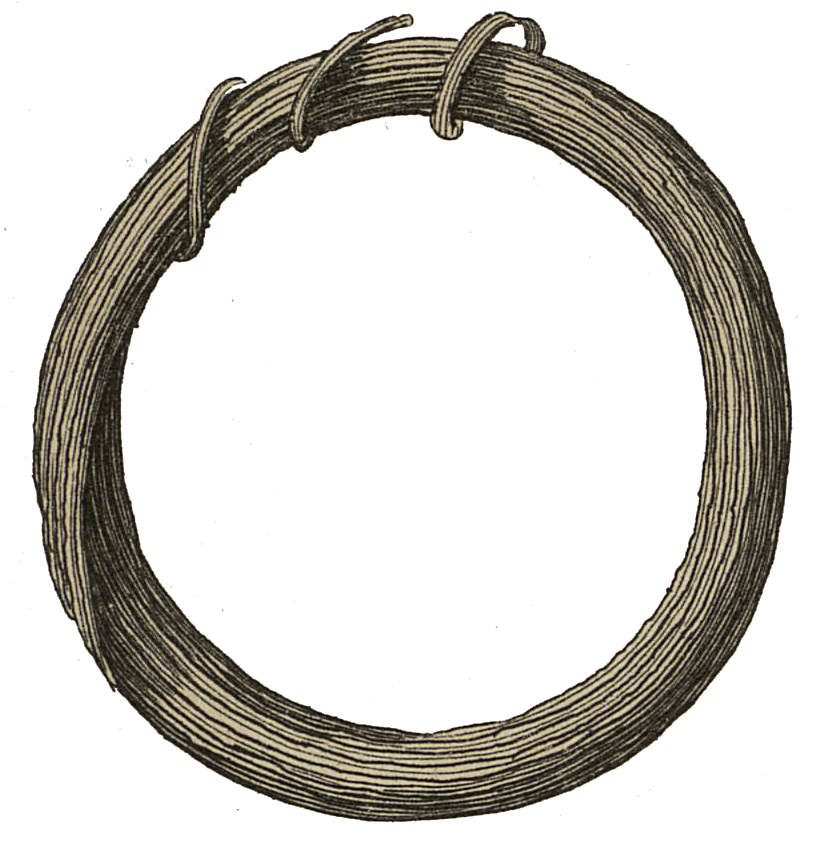

<div align="center" id="head">


<table>
<tr>
<td></td>
<td align="left">
<h1 style="margin:0">ResearchUserscript</h1>
<p style="margin:0.25em 0 0"><strong>Userscripts für die Forschung</strong><br/>Cairn · Tampermonkey · Violentmonkey</p>
</td>
</tr>
</table>

<a href="https://atelier.atechnologie.fr/" title="l'Atelier – Verein für Buchherstellung und Forschungswerkzeuge"></a>  
<sub>Entwickelt von <a href="https://atelier.atechnologie.fr/">l'Atelier</a> — Buchherstellung und Forschungswerkzeuge (EHESS)</sub>

<p>
🇫🇷 <a href="README.md">Français</a> ·
🇬🇧 <a href="README.en.md">English</a> ·
🇩🇪 <a href="README.de.md"><b>Deutsch</b></a> ·
🇪🇸 <a href="README.es.md">Español</a>
</p>

<p>
<a href="https://atelier.atechnologie.fr/"></a>
<a href="https://github.com/Atelier-Recherche/ResearchUserscript"></a>
</p>

</div>

---

## 📸 Vorschau

| Cairn | Download |
| :---: | :---: |
|  |  |

---
## 📖 Über

Sammlung von **Userscripts** für Forschende, Doktorand:innen und Studierende der Geistes- und Sozialwissenschaften. Jedes Skript automatisiert eine wiederkehrende Aufgabe auf einer akademischen Plattform (Download, Navigation, Export…), ohne den rechtmäßigen Zugang zu Inhalten zu ersetzen.

> Voraussetzung: ein Userscript-Manager — [Tampermonkey](https://www.tampermonkey.net/) oder [Violentmonkey](https://violentmonkey.github.io/).

---

## ⬇️ Schnelle Installation

1. Tampermonkey oder Violentmonkey im Browser installieren.
2. Die gewünschte `.user.js`-Datei öffnen (oder den Link *Installieren* unten anklicken).
3. Die Installation im Manager bestätigen.
4. Die Zielseite neu laden: das Skript aktiviert sich automatisch.

---

## 📜 Verfügbare Skripte

| Skript | Plattform | Beschreibung | Installieren |
|--------|------------|-------------|-----------|
| **Cairn PDF Downloader** | [Cairn.info](https://www.cairn.info/) / [shs.cairn.info](https://shs.cairn.info/) | Lädt alle Kapitel-PDFs eines frei zugänglichen Werks herunter, optional zu einer Datei zusammengeführt | [`cairn-pdf-downloader.user.js`](./cairn-pdf-downloader.user.js) |

---

### Cairn PDF Downloader

Auf der Seite eines **frei zugänglichen Buchs oder Dossiers** auf Cairn erscheint oben rechts ein Button *Tous les chapitres télécharger* / *Download all chapters*.

**Funktionen**

- Automatische Kapitelerkennung und sequenzieller PDF-Download
- Option, alle Kapitel zu **einem** PDF zusammenzuführen (Reihenfolge erhalten)
- Dateibenennung nach Kapitelnamen
- Verzögerungen zwischen Anfragen, um den Server nicht zu überlasten

**Verwendung**

1. Die Hauptseite eines frei zugänglichen Cairn-Werks öffnen (keine isolierte Kapitelseite).
2. Auf *Download all chapters* klicken.
3. Zusammenführung in ein PDF aktivieren oder deaktivieren, dann bestätigen.
4. Den Vorgang abwarten (mehrere Minuten je nach Kapitelzahl).

**Geltungsbereich**

- Funktioniert nur bei Inhalten, die in Ihrem Browser **bereits zugänglich** sind (Open Access oder authentifizierte Sitzung).
- Umgeht keine Paywalls und keine Zugriffsbeschränkungen.

---

## 📁 Repository-Struktur

```
ATResearchUserscript/
├── README.md
└── cairn-pdf-downloader.user.js   # offizielles Skript
```

Eventuelle `*.nomerge.js` / `*.debugmerge.js`-Dateien sind Entwicklungsvarianten und nicht für die übliche Installation gedacht.

---

## 🤝 Mitwirken

Beiträge sind willkommen: neues Userscript, Korrektur, UI- oder Kompatibilitätsverbesserung.

So schlagen Sie ein Skript vor:

1. Eine Datei `beschreibender-name.user.js` mit vollständigem UserScript-Header (`@name`, `@match`, `@description` usw.).
2. Einen kurzen Eintrag in der Tabelle *Verfügbare Skripte* dieses README.
3. Einen Nutzungsabschnitt (wie bei Cairn), falls das Verhalten nicht offensichtlich ist.

Nützliche Themenideen: Persée, OpenEdition, Gallica, HAL, Google Scholar, Zotero / bibliografischer Export usw.

---

## ⚠️ Hinweis

Diese Werkzeuge werden **wie besehen** bereitgestellt, zu Forschungs- und Komfortzwecken. Beachten Sie die Nutzungsbedingungen der betreffenden Sites, das Urheberrecht und die Lizenzen der Dokumente. Der Autor des Repositories ist weder mit Cairn.info noch mit den Zielplattformen verbunden.

---

## 📄 Lizenz

Vor öffentlicher Veröffentlichung festzulegen (MIT oder anderes).

---

## 🌐 Links

- 🌐 [l’Atelier](https://atelier.atechnologie.fr/)
- 📦 [GitHub-Repository](https://github.com/Atelier-Recherche/ResearchUserscript)
