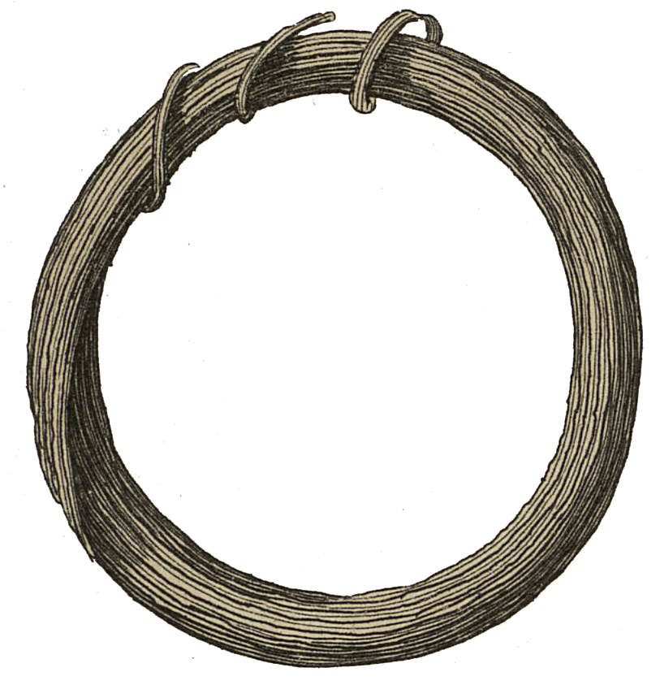

<div align="center" id="head">


<table>
<tr>
<td></td>
<td align="left">
<h1 style="margin:0">ResearchUserscript</h1>
<p style="margin:0.25em 0 0"><strong>Userscripts for research</strong><br/>Cairn · Tampermonkey · Violentmonkey</p>
</td>
</tr>
</table>

<a href="https://atelier.atechnologie.fr/" title="l'Atelier – book-making and research tools association"></a>  
<sub>Developed by <a href="https://atelier.atechnologie.fr/">l'Atelier</a> — book-making and research tools (EHESS)</sub>

<p>
🇫🇷 <a href="README.md">Français</a> ·
🇬🇧 <a href="README.en.md"><b>English</b></a> ·
🇩🇪 <a href="README.de.md">Deutsch</a> ·
🇪🇸 <a href="README.es.md">Español</a>
</p>

<p>
<a href="https://atelier.atechnologie.fr/"></a>
<a href="https://github.com/Atelier-Recherche/ResearchUserscript"></a>
</p>

</div>

---

## 📸 Preview

| Cairn | Download |
| :---: | :---: |
|  |  |

---
## 📖 About

A collection of **userscripts** for researchers, PhD candidates and students in the humanities and social sciences. Each script automates a repetitive task on an academic platform (download, navigation, export…), without replacing legitimate access to content.

> Prerequisite: a userscript manager — [Tampermonkey](https://www.tampermonkey.net/) or [Violentmonkey](https://violentmonkey.github.io/).

---

## ⬇️ Quick install

1. Install Tampermonkey or Violentmonkey in your browser.
2. Open the desired `.user.js` file (or click the *Install* link below).
3. Confirm installation in the manager.
4. Reload the target page: the script activates automatically.

---

## 📜 Available scripts

| Script | Platform | Description | Install |
|--------|------------|-------------|-----------|
| **Cairn PDF Downloader** | [Cairn.info](https://www.cairn.info/) / [shs.cairn.info](https://shs.cairn.info/) | Downloads all chapter PDFs of an open-access work, with optional merge into a single file | [`cairn-pdf-downloader.user.js`](./cairn-pdf-downloader.user.js) |

---

### Cairn PDF Downloader

On the page of an **open-access book or dossier** on Cairn, a *Download all chapters* button appears at the top right.

**Features**

- Automatic chapter detection and sequential PDF download
- Option to **merge** all chapters into one PDF (order preserved)
- File naming from chapter titles
- Delays between requests to avoid overloading the server

**Usage**

1. Open the main page of a Cairn open-access work (not an isolated chapter page).
2. Click *Download all chapters*.
3. Check or uncheck merge into a single PDF, then confirm.
4. Wait for the process to finish (several minutes depending on chapter count).

**Scope**

- Works only on content **already accessible** via your browser (open access or authenticated session).
- Does not bypass paywalls or access restrictions.

---

## 📁 Repository structure

```
ATResearchUserscript/
├── README.md
└── cairn-pdf-downloader.user.js   # official script
```

Any `*.nomerge.js` / `*.debugmerge.js` files are development variants and are not for regular installation.

---

## 🤝 Contributing

Contributions are welcome: new userscript, fix, UI or compatibility improvement.

To propose a script:

1. A `descriptive-name.user.js` file with a complete UserScript header (`@name`, `@match`, `@description`, etc.).
2. A short entry in the *Available scripts* table of this README.
3. A usage section (as for Cairn) if behaviour is not obvious.

Useful domain ideas: Persée, OpenEdition, Gallica, HAL, Google Scholar, Zotero / bibliographic export, etc.

---

## ⚠️ Disclaimer

These tools are provided **as is**, for research and convenience. Respect the terms of use of the sites concerned, copyright and document licences. The repository author is not affiliated with Cairn.info or the targeted platforms.

---

## 📄 License

To be specified (MIT or other) before public release.

---

## 🌐 Links

- 🌐 [l’Atelier](https://atelier.atechnologie.fr/)
- 📦 [GitHub repository](https://github.com/Atelier-Recherche/ResearchUserscript)
