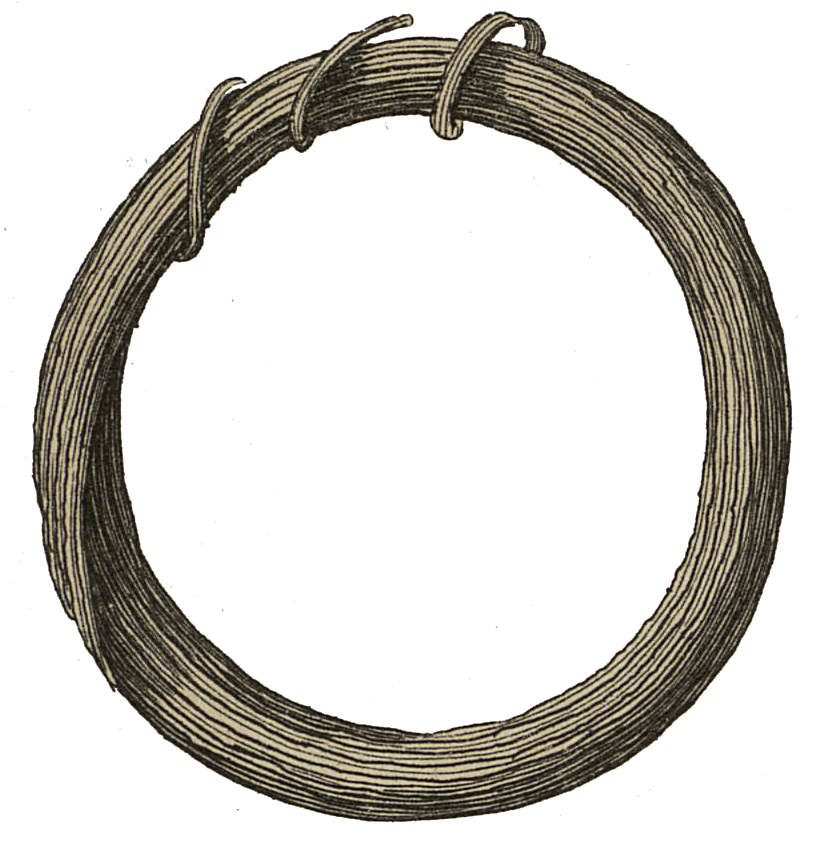

<div align="center" id="head">


<table>
<tr>
<td></td>
<td align="left">
<h1 style="margin:0">ResearchUserscript</h1>
<p style="margin:0.25em 0 0"><strong>Userscripts para la investigación</strong><br/>Cairn · Tampermonkey · Violentmonkey</p>
</td>
</tr>
</table>

<a href="https://atelier.atechnologie.fr/" title="l'Atelier – asociación de fabricación de libros y herramientas de investigación"></a>  
<sub>Desarrollado por <a href="https://atelier.atechnologie.fr/">l'Atelier</a> — fabricación de libros y herramientas de investigación (EHESS)</sub>

<p>
🇫🇷 <a href="README.md">Français</a> ·
🇬🇧 <a href="README.en.md">English</a> ·
🇩🇪 <a href="README.de.md">Deutsch</a> ·
🇪🇸 <a href="README.es.md"><b>Español</b></a>
</p>

<p>
<a href="https://atelier.atechnologie.fr/"></a>
<a href="https://github.com/Atelier-Recherche/ResearchUserscript"></a>
</p>

</div>

---

## 📸 Vista previa

| Cairn | Descarga |
| :---: | :---: |
|  |  |

---
## 📖 Acerca de

Colección de **userscripts** destinados a investigadores, doctorandos y estudiantes de ciencias humanas y sociales. Cada script automatiza una tarea repetitiva en una plataforma académica (descarga, navegación, exportación…), sin sustituir el acceso legítimo a los contenidos.

> Requisito previo: un gestor de userscripts — [Tampermonkey](https://www.tampermonkey.net/) o [Violentmonkey](https://violentmonkey.github.io/).

---

## ⬇️ Instalación rápida

1. Instale Tampermonkey o Violentmonkey en su navegador.
2. Abra el archivo `.user.js` del script deseado (o haga clic en el enlace *Instalar* más abajo).
3. Confirme la instalación en el gestor.
4. Recargue la página de destino: el script se activa automáticamente.

---

## 📜 Scripts disponibles

| Script | Plataforma | Descripción | Instalar |
|--------|------------|-------------|-----------|
| **Cairn PDF Downloader** | [Cairn.info](https://www.cairn.info/) / [shs.cairn.info](https://shs.cairn.info/) | Descarga todos los PDF de los capítulos de una obra en acceso libre, con opción de fusionarlos en un solo archivo | [`cairn-pdf-downloader.user.js`](./cairn-pdf-downloader.user.js) |

---

### Cairn PDF Downloader

En la página de un **libro o dossier en acceso libre** en Cairn, aparece un botón *Télécharger tous les chapitres* / *Download all chapters* arriba a la derecha.

**Funciones**

- Detección automática de capítulos y descarga secuencial de PDF
- Opción para **fusionar** todos los capítulos en un solo PDF (orden respetado)
- Nomenclatura de archivos a partir de los títulos de capítulos
- Pausas entre peticiones para no sobrecargar el servidor

**Uso**

1. Abra la página principal de una obra Cairn en acceso libre (no una página de capítulo aislada).
2. Haga clic en *Download all chapters*.
3. Marque o desmarque la fusión en un solo PDF y valide.
4. Espere el final del proceso (varios minutos según el número de capítulos).

**Ámbito**

- Funciona únicamente con contenidos **ya accesibles** vía su navegador (acceso libre o sesión autenticada).
- No elude paywalls ni restricciones de acceso.

---

## 📁 Estructura del repositorio

```
ATResearchUserscript/
├── README.md
└── cairn-pdf-downloader.user.js   # script oficial
```

Los archivos `*.nomerge.js` / `*.debugmerge.js` eventuales son variantes de desarrollo y no están destinados a la instalación habitual.

---

## 🤝 Contribuir

Las contribuciones son bienvenidas: nuevo userscript, corrección, mejora de UI o de compatibilidad.

Para proponer un script:

1. Un archivo `nombre-descriptivo.user.js` con un encabezado UserScript completo (`@name`, `@match`, `@description`, etc.).
2. Una entrada breve en la tabla *Scripts disponibles* de este README.
3. Una sección de uso (como para Cairn) si el comportamiento no es evidente.

Ideas de ámbitos útiles: Persée, OpenEdition, Gallica, HAL, Google Scholar, Zotero / exportación bibliográfica, etc.

---

## ⚠️ Aviso

Estas herramientas se proporcionan **tal cual**, con fines de investigación y comodidad de uso. Respete las condiciones de uso de los sitios afectados, el derecho de autor y las licencias de los documentos. El autor del repositorio no está afiliado a Cairn.info ni a las plataformas objetivo.

---

## 📄 Licencia

Por precisar (MIT u otra) antes de la publicación pública.

---

## 🌐 Enlaces

- 🌐 [l’Atelier](https://atelier.atechnologie.fr/)
- 📦 [Repositorio GitHub](https://github.com/Atelier-Recherche/ResearchUserscript)
